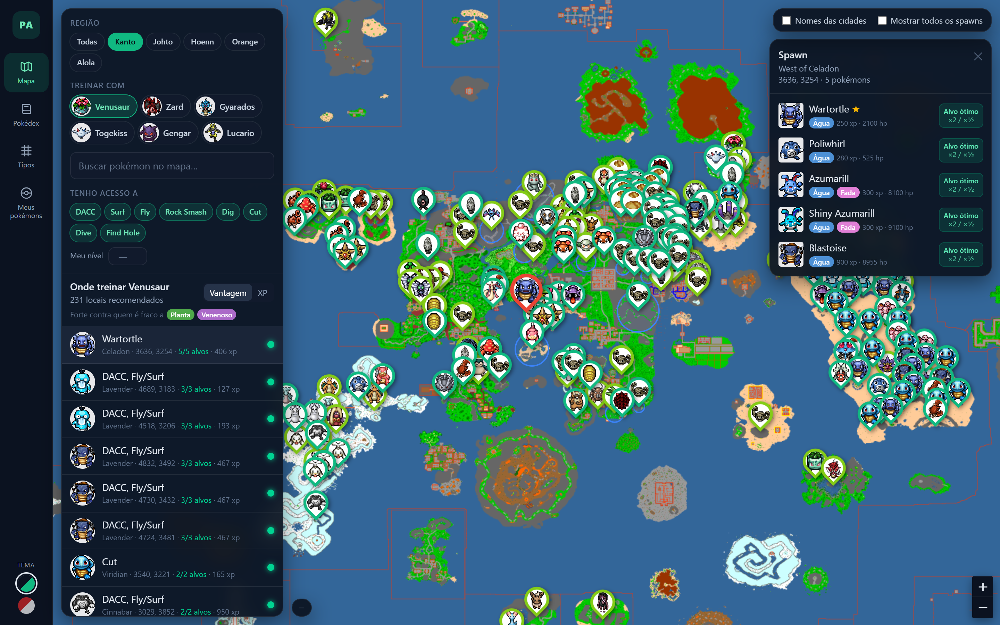
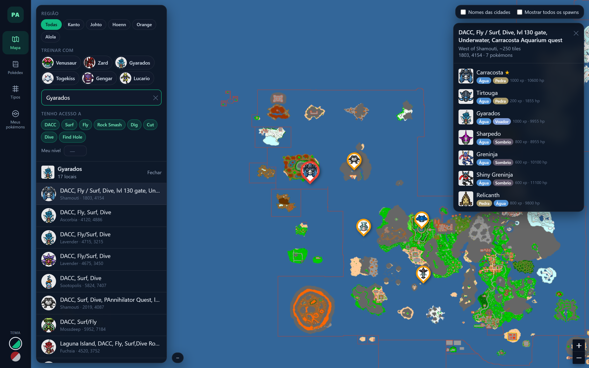
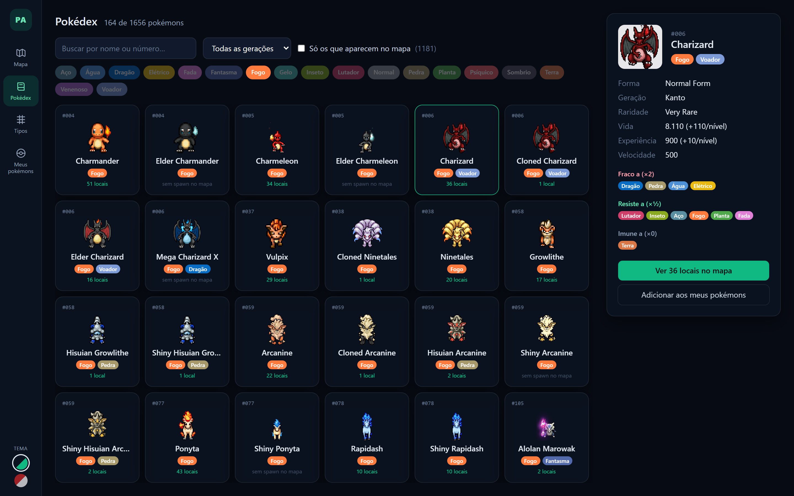
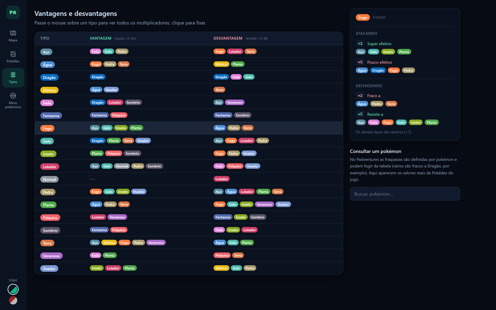
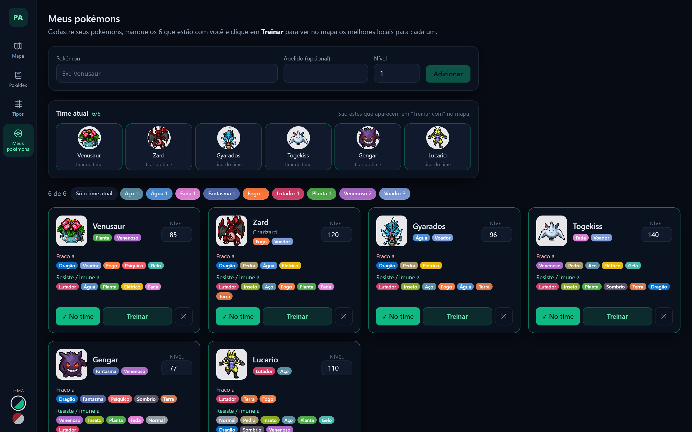
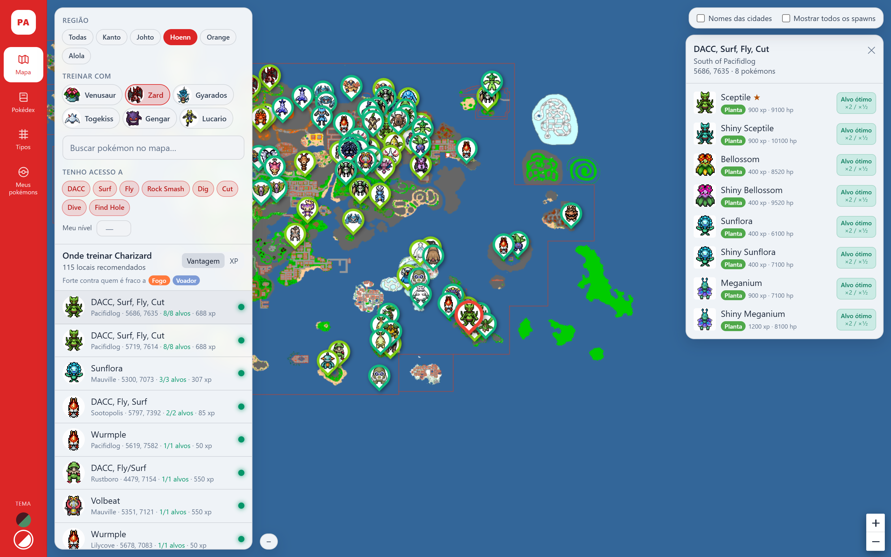

# PA Trainer

App desktop de apoio para o [Padventures](https://www.padventures.org/) (OT Pokémon): mapa de spawns offline e guia de onde treinar cada pokémon.

Autor: Rodrigo Caon — [rodrigocaon.com.br](https://rodrigocaon.com.br)



## Funções

### Onde treinar

Escolha um dos seus pokémons e o mapa destaca os locais onde ele tem vantagem de tipo, usando as fraquezas reais de cada pokémon do jogo. Cada local mostra quantos alvos são bons, o XP médio e os requisitos de acesso; a lista pode ser ordenada por vantagem ou por XP.

### Mapa de spawns

Reprodução do [mapa oficial](https://map.padventures.org/) com todos os spawns, busca por pokémon, filtro por região (Kanto, Johto, Hoenn, Orange, Alola), por requisito de acesso (DACC, Surf, Fly, Cut…) e por nível.



### Pokédex

Todas as fichas da Pokédex oficial, com filtro por nome, tipo, geração e "só os que aparecem no mapa". A ficha traz atributos, fraquezas e atalhos para ver os locais no mapa ou adicionar ao time.



### Vantagens e desvantagens

Uma linha por tipo, com o que ele vence e o que o vence. Passar o mouse mostra todos os multiplicadores (×2, ×½, ×0), atacando e defendendo.



### Meus pokémons

Cadastro de todos os seus pokémons com apelido e nível, salvo localmente. Marque os 6 que estão com você (time atual) para que só eles apareçam em "Treinar com" no mapa, e filtre a lista por tipo. O botão Treinar leva direto ao mapa com as recomendações.



### Temas

Dois temas de cor, trocados pelo seletor no menu lateral: Esmeralda (escuro) e Pokédex (vermelho e branco).



## Stack

Tauri v2 (Rust) · Vue 3 · Vite · Tailwind CSS v4 · Leaflet

## Como rodar

Requisitos: Node.js 20+, Rust e os [pré-requisitos do Tauri](https://tauri.app/start/prerequisites/).

```bash
npm install
npm run tauri dev     # desenvolvimento
npm run tauri build   # gera o instalador
```

## Atualizar os dados

Os tiles do mapa, os spawns, os sprites e a Pokédex ficam em `public/` e vêm do site oficial:

```bash
npm run scrape              # baixa só o que falta
npm run scrape -- --refresh # rebaixa spawns e Pokédex
```

## Estrutura

- `scripts/scrape.mjs` — coleta mapa, spawns e Pokédex
- `src/lib/` — estado, tabela de tipos, recomendação de treino, requisitos e regiões
- `src/components/` — telas (mapa, Pokédex, tipos, meus pokémons)
- `src-tauri/` — app Tauri; os comandos Rust salvam o time em disco

Os dados e imagens do jogo pertencem ao Padventures; este é um projeto de fã, sem vínculo oficial.
